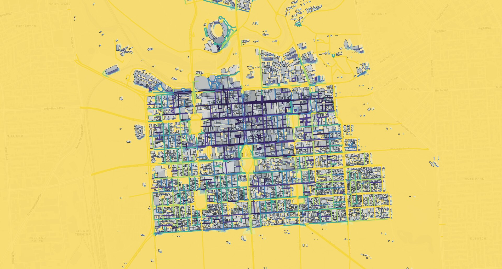

# Adelaide on the shortest day

Hours of direct sun on 21 June 2026, from 9 am to 3 pm, along every street and over every park in the City of Adelaide, with the 7,341 buildings at their heights casting the shadows. **Live version, with an interactive map and the shadows through the day:** [getplotlay.com/showcase/adelaide-winter-sun](https://www.getplotlay.com/showcase/adelaide-winter-sun/)



**23% of the street length in the city's grids gets under 2 hours of sun on the shortest day.** East-west streets fare worst: 30% of their length is under 2 hours, against 16% of north-south streets. Rundle Mall averages 0.2 hours. Open ground in the council area, most of it Park Lands, averages 5.2 of a possible 6 hours.

The hours were worked out in [Plotlay](https://www.getplotlay.com) with Sun and shade, at city scale: every building at its height, a 1 m grid over the whole council area (21.6 million cells), the sun's position every 15 minutes. The streets and parks were then summed as columns of their own data layers, the same way the app's "Who gets the most sun" does.

[](https://app.plotlay.io/?example=adelaide-winter-sun&as=client)

## Read this first

- **Direct sun only.** No light from the sky, no reflections off glass or walls, no cloud. The ground is taken as level.
- **No verandahs, awnings or trees.** Many city footpaths are under a verandah; the hours here are along the middle of the street, as if nothing but buildings stood in the way.
- **Accuracy depends on the building heights and the data.** The heights are those of the [Adelaide in Sepia](https://github.com/cjmuldoon/plotlay-adelaide-in-sepia) showcase: the council's 3D model (files of 2016) or OpenStreetMap for nine buildings in ten, and estimates from the kind and size of building for the rest (708 of 7,443 outlines). A building put up or pulled down since is shown as the data has it.
- **Not a certified solar access or overshadowing assessment.** It is a city-wide picture from open data.

## The numbers

| Built-up streets (within 40 m of a building) | km | Mean hours | Under 2 h | Under 1 h |
|---|---|---|---|---|
| All | 142.6 | 3.86 | 22.9% | 15.1% |
| East-west | 70.7 | 3.62 | 29.9% | 22.6% |
| North-south | 71.9 | 4.09 | 16.1% | 7.7% |

102 of the 379 named streets get under 2 hours along more than half their built-up length. Of the long streets (500 m or more in the grids), Rundle Mall has the least sun (0.17 h), then Gawler Place (1.57 h), Ifould Street (1.69 h) and Hindley Street (1.72 h).

Of the squares, Hindmarsh Square has the least (4.1 h on average, 17% of it under 2 hours); Victoria Square/Tarntanyangga 5.0 h; Wellington Square in North Adelaide 6.0 h, sun all day.

Why the grid matters: in June the sun stays low in the north, about 32 degrees up at noon. On an east-west street, the buildings along its north side throw their shadows across it most of the day. A north-south street gets sun down its length for an hour or two either side of noon.

## What's here

| Folder | What |
|---|---|
| [`data/`](data) | `street_segments.geojson`: every street part with its mean hours, % under 2 hours, which way it runs, and its built-up metres and hours. `streets.csv`: the named streets, built-up parts joined. `parks.csv` and `parks.geojson`: parks, gardens and squares with their hours. `sun_hours_2m.tif`: the hours on the ground in 2 m cells, EPSG:32754, roofs as no data. `numbers.json`: every number on the page. |
| [`python/`](python) | A short notebook that gets the numbers again from `data/`: [`adelaide_winter_sun.ipynb`](python/adelaide_winter_sun.ipynb) |
| [`visuals/`](visuals) | The map of hours, the charts and the shadows from 9 am to 3 pm, all made in Plotlay |

### Run the notebook

```
python3 -m venv .venv
.venv/bin/pip install -r python/requirements.txt
cd python && ../.venv/bin/jupyter lab adelaide_winter_sun.ipynb
```

## How it was made

1. **Buildings**: the 7,341 buildings (7,443 outlines with their mapped parts) inside the City of Adelaide, each at its height, as two Plotlay data layers.
2. **Sun and shade at city scale**: a 1 m grid over the council area; for each cell, the sun's position every 15 minutes from 9 am to 3 pm on 21 June 2026, and whether a building stands between the cell and the sun. A cell on a roof takes the roof's height. Hours are the 15-minute steps in sun.
3. **Streets**: OpenStreetMap's streets inside the council area, sampled every metre along the middle; samples on a roof (a street under a building) left out. "Built-up" is within 40 m of a building, which keeps the two street grids and leaves out the roads across the Park Lands.
4. **Parks**: OpenStreetMap's parks, gardens and squares, with their outlines joined where they are mapped in parts, and the mean hours over their ground.
5. **Which way a street runs**: east-west where its bearing is between 45 and 135 degrees, north-south otherwise.

## Sources and licences

- Streets, parks, building outlines, heights and levels: © OpenStreetMap contributors, [Open Database Licence](https://www.openstreetmap.org/copyright). Streets and parks fetched with the Overpass API on 20 November 2026; buildings on 15 November 2026.
- Heights for 5,481 buildings: [3D Model of the City of Adelaide](https://data.sa.gov.au/data/dataset/3d-model), City of Adelaide, Data.SA, Creative Commons Attribution.
- Council boundary: Australian Bureau of Statistics, ASGS Edition 3, CC BY 4.0.

The data in `data/` is made from OpenStreetMap and is licensed under the Open Database Licence 1.0 (`LICENSE-DATA`): if you publish a database made from it, offer it under the same licence. The pictures in `visuals/` are produced works under CC BY 4.0, crediting OpenStreetMap. The code is MIT (`LICENSE`). See `NOTICE`.

This is independent work using open data, not endorsed by the City of Adelaide or the South Australian Government.
